<div align="center">

# x86Sim

### Apple's iOS Simulator on Linux. No Mac required.

Run the real iPhone, iPad, Apple TV, Apple Watch and Apple Vision Pro simulators on an ordinary x86-64 Linux PC.
Build your app, run it, test it, debug it and ship it, without leaving Linux.

[](https://github.com/x86sim/x86sim/releases/latest)
[](LICENSE)
[](#requirements)

[**Download**](https://github.com/x86sim/x86sim/releases/latest) · [Quick start](#quick-start) · [What you can do](#what-you-can-do) · [For AI agents](#for-ai-agents) · [Documentation](#documentation) · [vs Apple's Simulator](docs/PARITY.md)

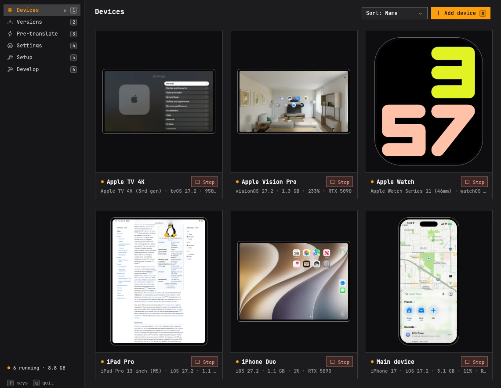

</div>

## What is x86Sim?

Apple ships its device simulators for Macs only. **x86Sim runs those same simulators, unmodified, on Linux.**

One download gives you a desktop app that fetches iOS straight from Apple, sets itself up, and boots a real
simulated iPhone on your screen: the same home screen, the same Settings, Safari, Photos, Maps and Files, the same
system frameworks your app links against. Then add an iPad, an Apple TV, an Apple Watch or an Apple Vision Pro, and
run them all at once.

- **No Mac.** Everything runs on your Linux PC, including building apps.
- **No Apple ID to get started.** The simulators download from Apple's public catalogue, the one Xcode reads.
- **Not a lookalike.** These are Apple's own simulator runtimes. In our coverage suite, which checks the public
  frameworks of the SDK one by one, x86Sim gave the same results as Apple's Simulator on a Mac on all four
  platforms ([how it compares](docs/PARITY.md)).
- **Free and open source**, GPL-3.0-or-later.

<div align="center">
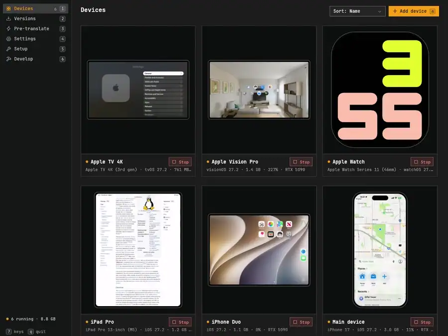
</div>

## Quick start

1. Download `x86sim-*-x86_64.AppImage` from the [latest release](https://github.com/x86sim/x86sim/releases/latest).
2. Make it executable and run it:
   ```sh
   chmod +x x86sim-*-x86_64.AppImage
   ./x86sim-*-x86_64.AppImage
   ```
3. Follow the **Setup** page. It checks your computer, downloads iOS 27.2 from Apple (about 8 GB), gets it ready
   and creates your first iPhone.

That's it. On most distributions nothing is installed outside your home directory and no root is needed. Where
unprivileged user namespaces are blocked (Ubuntu's default, for example), Setup asks for your password once.

For an Apple TV, an Apple Watch or an Apple Vision Pro, download tvOS, watchOS or visionOS on the **Versions** page,
then choose **Add device**.

## What you can do

<table>
<tr>
<td width="50%">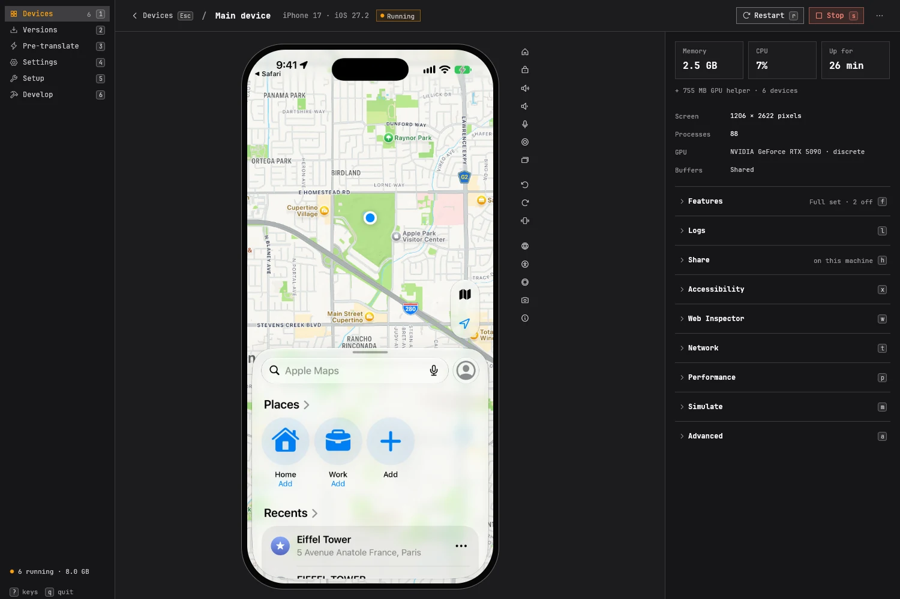</td>
<td width="50%">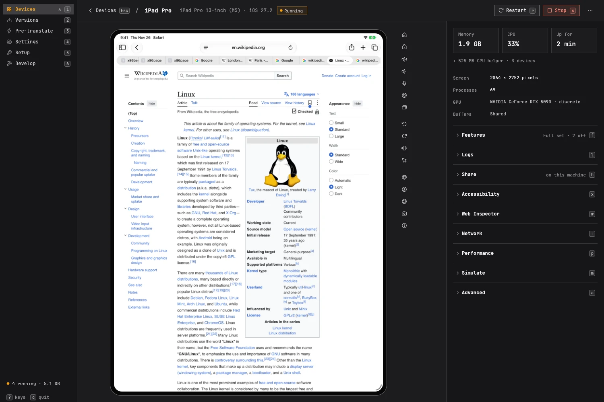</td>
</tr>
<tr>
<td valign="top"><b>Run real iOS.</b> Every device boots to its home screen with Apple's stock apps. Click to tap, drag to swipe, type on your keyboard, paste from your Linux clipboard.</td>
<td valign="top"><b>85 device models.</b> iPhone 11 to iPhone 18 Pro Max, every current iPad, Apple TV 4K, Apple Watch and Apple Vision Pro. Run several at once; each has its own apps and data.</td>
</tr>
<tr>
<td width="50%">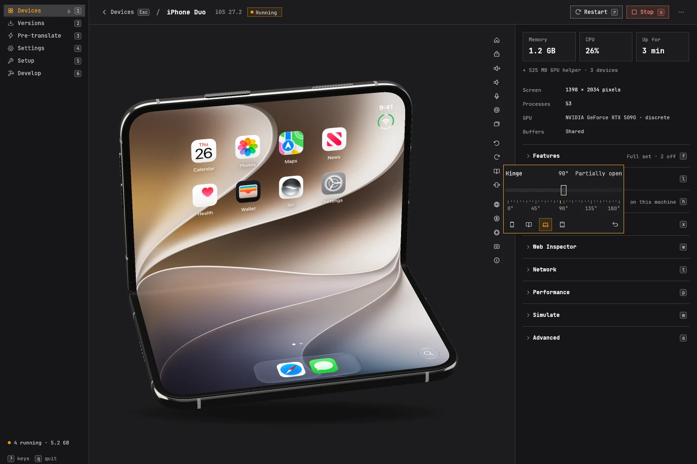</td>
<td width="50%">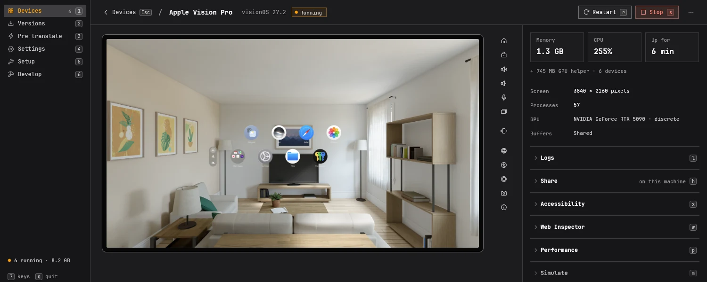</td>
</tr>
<tr>
<td valign="top"><b>Fold the iPhone Duo.</b> The dual-screen iPhone opens and closes on a hinge slider, in 3D, with both screens live. Check your layouts in every pose.</td>
<td valign="top"><b>Apple Vision Pro on your desktop.</b> Look and pinch with the mouse, open the Home View with the Digital Crown, and run visionOS apps in a rendered room.</td>
</tr>
<tr>
<td width="50%">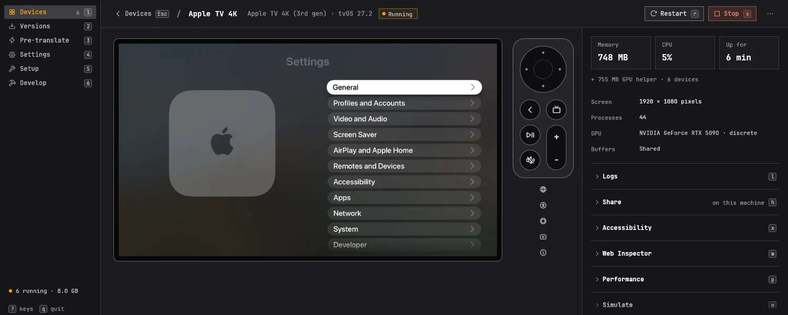</td>
<td width="50%">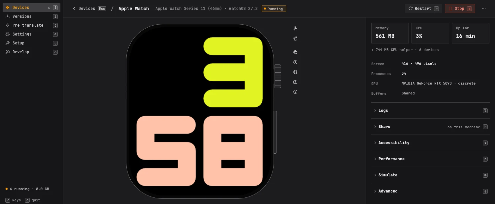</td>
</tr>
<tr>
<td valign="top"><b>Apple TV</b>, with a Siri Remote on screen and your arrow keys.</td>
<td valign="top"><b>Apple Watch</b>, with a Digital Crown and side button.</td>
</tr>
</table>

### Build, run and ship apps from Linux

x86Sim includes a complete app toolchain, so the whole loop happens on one machine:

```sh
x86sim dev setup                      # install the toolchain into your home directory (no root)
x86sim dev new HelloApp               # a new SwiftUI app
x86sim dev run HelloApp               # build it, install it on a device and launch it
```

- **Your stack works.** Swift and SwiftUI, Objective-C, React Native and Expo, Flutter, Kotlin Multiplatform,
  .NET for iOS, Rust (Tauri, Dioxus, Bevy), Capacitor, Cordova, NativeScript, Godot and Unity projects, and
  existing Xcode projects.
- **Install what you already have.** Drop a simulator build, an `.ipa` or an `.xcarchive` on a device.
- **Go to a real iPhone and the App Store.** Pair an iPhone, install and debug on it, then sign and upload to
  TestFlight and App Store Connect, all from Linux.

See [Building and shipping apps](docs/BUILDING-APPS.md).

### Test and debug like you would in Xcode

- **XCTest and XCUITest** runs with per-test results and JUnit XML for CI.
- **LLDB** with breakpoints, stepping and Swift values. **A CPU profiler** in the style of Instruments' Time
  Profiler.
- **Web Inspector** for Safari and your app's web views. **A network inspector** that can mock responses.
- **Accessibility Inspector**: click any element to see what VoiceOver sees, and run an audit that finds missing
  labels, small touch targets and low contrast, with a fix for each.
- **Everything `simctl` does**: push notifications, location and routes, dark mode, Dynamic Type, status bar
  overrides for clean screenshots, Face ID, screen recording, and more.

See [Testing](docs/TESTING.md) and [Debugging, profiling and Web Inspector](docs/DEBUGGING.md).

### Open any device in a browser

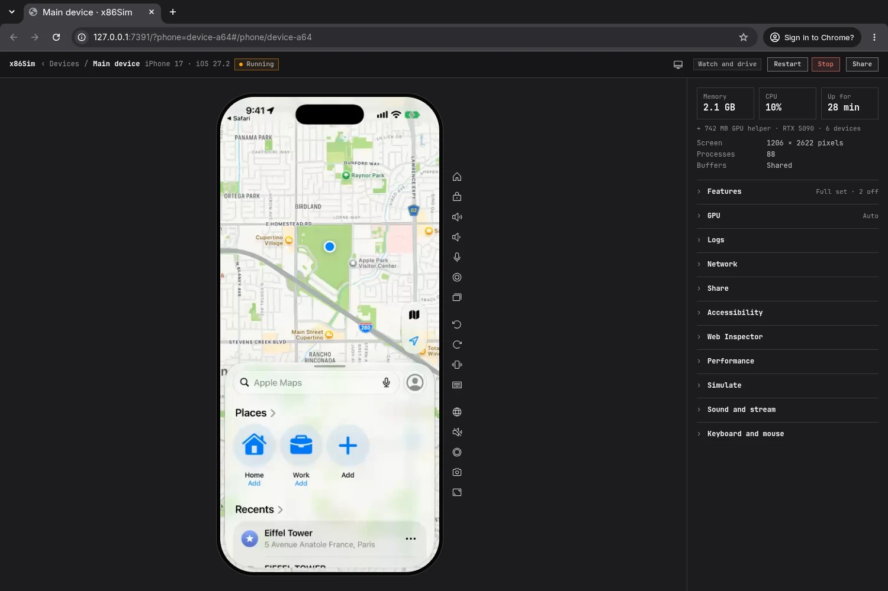

`x86sim serve` puts every device in a browser tab with live video, sound, touch and keyboard. Share a link with a
teammate, a designer or a client over Tailscale or a Cloudflare tunnel: view-only, or with full control. It works
from a phone's browser too, with real multi-touch.

## For AI agents

x86Sim was built so a coding agent can do what a human tester does: run the app, look at the screen, tap through
it and check the result.

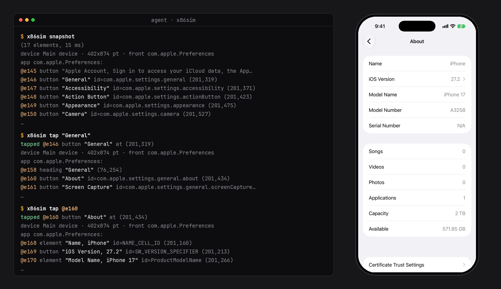

- **The screen as text.** One call returns every element on screen with a stable reference. The agent taps, types
  and scrolls by reference and gets the next screen back, so it doesn't need a screenshot for every step. Text
  drawn as pixels, in games for example, is read by OCR.
- **More than 100 tools over MCP.** Build, install, launch, read logs and crashes, run tests, debug, profile,
  inspect the network and the web view, audit accessibility, set location, send a push.
- **Devices on demand.** A pool keeps devices booted. An agent takes one, uses it and hands it back clean, so
  several agents and CI jobs can work in parallel.
- **A human in the loop.** Open the agent's device in your browser and watch, or take over.

```sh
claude mcp add x86sim -- /path/to/x86sim-*.AppImage mcp
```

Agents that work from a shell can use the skill file in [skills/x86sim/SKILL.md](skills/x86sim/SKILL.md). See
[x86Sim for AI agents](docs/AGENT-TOOLS.md).

## Requirements

| | |
|---|---|
| **OS** | x86-64 Linux with glibc 2.39 or newer: Ubuntu 24.04+, Debian 13, Fedora 39+, Arch and derivatives |
| **CPU** | x86-64 with SSE4.1, POPCNT and CX16 (any PC from the last decade) |
| **GPU** | A Vulkan GPU and driver: NVIDIA (proprietary driver), AMD or Intel (Mesa). Without one, rendering falls back to software |
| **Memory** | 8 GB minimum, 16 GB recommended |
| **Disk** | 45 GB free while iOS downloads and unpacks |

Everything else is inside the AppImage. It updates itself, on a stable or a pre-release channel.

## Supported devices

| Device | System | Models | Input |
|---|---|---|---|
| **iPhone** | iOS 27 | iPhone 11 to iPhone 18 Pro Max, and the dual-screen iPhone Duo | Touch and gestures, keyboard, Home, lock and volume |
| **iPad** | iPadOS 27 | iPad, iPad mini, iPad Air, iPad Pro | Touch and gestures, keyboard, pointer |
| **Apple TV** | tvOS 27 | Apple TV 4K | Siri Remote on screen; arrow keys, Return and Escape |
| **Apple Watch** | watchOS 27 | Series 9 to 12, SE 3, Ultra 2 to 4 | Touch, Digital Crown, side button |
| **Apple Vision Pro** | visionOS 27 | At 4K or at 1080p | Look and pinch with the mouse, Digital Crown |

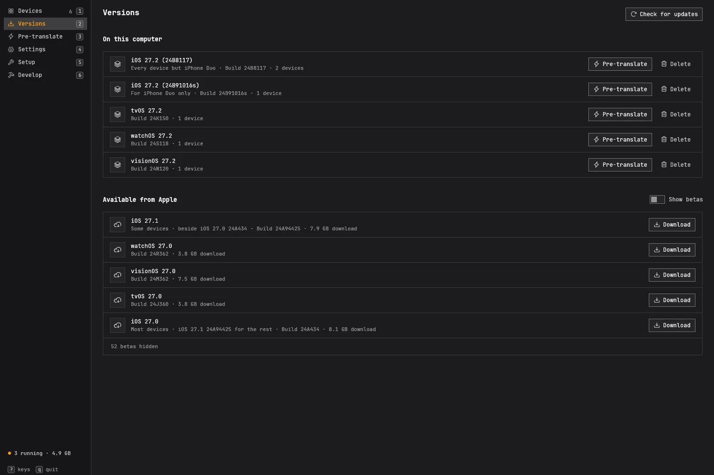

Simulators come straight from Apple's own catalogue. Each copy is downloaded on your machine and is never
redistributed. iOS 27.2 is the default; the Versions page lists the other releases Apple offers.

## How it works

x86Sim downloads a simulator from Apple and runs it as it is. Three things make that possible on a Linux PC:

- **A macOS-compatible system layer** ([Darling](https://github.com/darlinghq/darling)) loads Apple's programs and
  answers their system calls. Each device runs in its own container.
- **A translator** ([dynarmic](https://github.com/azahar-emu/dynarmic)) turns the simulator's arm64 code into
  x86-64 code. Most of it is translated ahead of time, once, so devices boot and apps launch quickly.
- **Metal on Vulkan** ([metal2vulkan](https://github.com/steelbrain/metal2vulkan)) draws Apple's graphics on your
  GPU.

Small stand-ins replace what a Mac would provide around the simulator: the display, input, audio, networking and
file services. [ARCHITECTURE.md](docs/ARCHITECTURE.md) has the full picture.

## What doesn't work yet

x86Sim is young. The simulators boot, stock and third-party apps run, and the tools above work. Known gaps:

- **App Store downloads don't run.** They are encrypted for the device they were bought on. Use a development,
  ad-hoc or enterprise build, or build from source.
- **Some of Instruments is missing**: there is a CPU profiler, but no Allocations or Leaks, no memory graph and
  no view debugger.
- **Hardware the simulator doesn't have**: no camera, accelerometer, Apple Pencil, external displays or CarPlay.
  An Apple Watch can't be paired with an iPhone.
- **Sound** plays in the browser view; on the desktop it is opt-in (`X86SIM_AUDIO=1`).
- **Apple Intelligence** (FoundationModels) needs a Mac to answer, as it does in Apple's own simulator.

[PARITY.md](docs/PARITY.md) compares every area with Apple's Simulator, gaps included, and says how each was
checked.

## Documentation

| | |
|---|---|
| [Using x86Sim](docs/USAGE.md) | The launcher, the `x86sim` command line, device builds, the device pool, the browser view |
| [Building and shipping apps](docs/BUILDING-APPS.md) | The app toolchain: every supported framework, real devices, TestFlight and the App Store |
| [Testing](docs/TESTING.md) | XCTest, XCUITest and the Accessibility Inspector |
| [Debugging, profiling and Web Inspector](docs/DEBUGGING.md) | LLDB, the CPU profiler, Web Inspector |
| [x86Sim for AI agents](docs/AGENT-TOOLS.md) | The screen as text, actions, and every MCP tool |
| [x86Sim and Apple's Simulator](docs/PARITY.md) | A feature-by-feature comparison, and how it was verified |
| [Architecture](docs/ARCHITECTURE.md) | How it works, part by part; [Metal](docs/METAL.md); [wire formats](docs/protocols) |
| [Developing x86Sim](docs/DEVELOPMENT.md) | Building from source, the repository layout, [releases](docs/RELEASE.md) |
| [Press](docs/press) | The launch announcement, images and video |

## Building from source

```sh
git clone --recursive https://github.com/x86sim/x86sim.git
cd x86sim
cp x86sim.env.example x86sim.env

make darling-install                             # the system layer; asks for sudo
make mtlvk                                       # Metal on Vulkan
linux/arm64jit/install.sh                        # the arm64 translator
(cd tools/launcher && cargo build --release)     # the launcher and command-line tools
```

Everything builds on Linux. [DEVELOPMENT.md](docs/DEVELOPMENT.md) covers the dependencies and day-to-day use.

## License and credits

x86Sim is free software, licensed under the [GNU General Public License v3.0 or later](LICENSE). Bundled components
keep their own licenses; see [NOTICE](NOTICE).

x86Sim builds on:

- [Darling](https://github.com/darlinghq/darling), used through the [x86sim fork](https://github.com/x86sim/darling)
- [dynarmic](https://github.com/azahar-emu/dynarmic), used through the [x86sim fork](https://github.com/x86sim/dynarmic)
- [metal2vulkan](https://github.com/steelbrain/metal2vulkan), used through the [x86sim fork](https://github.com/x86sim/metal2vulkan)
- [omarchy-apple-dev](https://github.com/joshuaswarren/omarchy-apple-dev), the app toolchain behind `x86sim dev`, used through the [x86sim fork](https://github.com/x86sim/omarchy-apple-dev)
- [ipsw](https://github.com/blacktop/ipsw), [7-Zip](https://www.7-zip.org),
  [dnspython](https://github.com/rthalley/dnspython), astcenc and lzfse

Each fork carries its changes on a branch named `x86sim`.

Thanks to [agent-sim](https://github.com/Developing-Gamer/agent-sim) for ideas on driving phones from AI agents.

Apple's simulator runtimes, SDKs and Xcode are not included and are never redistributed. Apple, iPhone, iPad,
Apple TV, Apple Watch, Apple Vision Pro, iOS, Xcode and Metal are trademarks of Apple Inc. x86Sim is not affiliated
with or endorsed by Apple.
